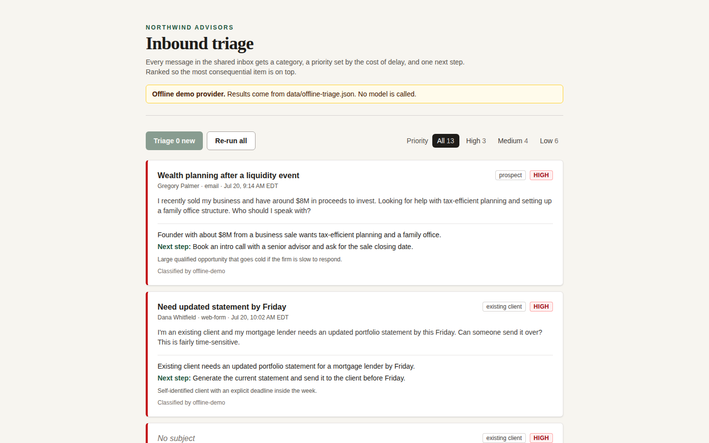
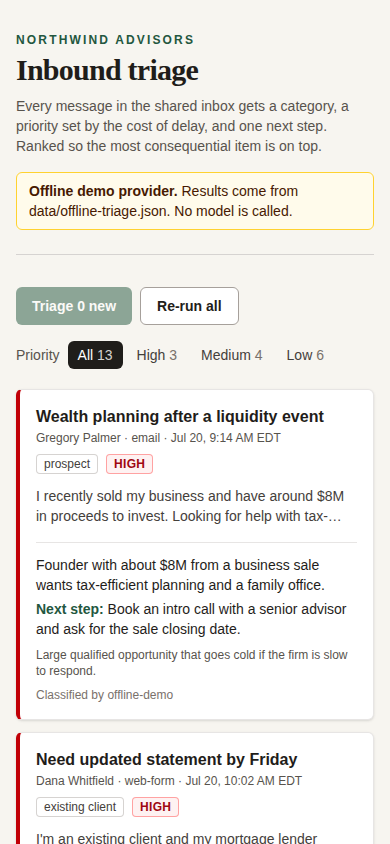
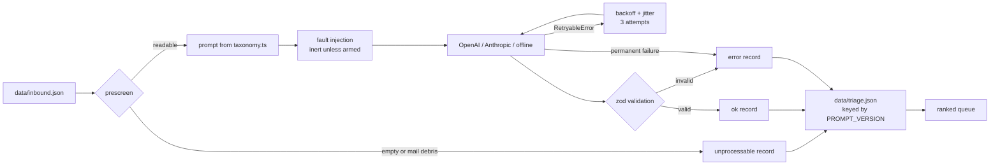
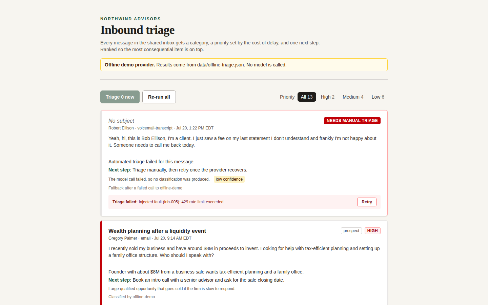

# Inbound Triage Assistant

An LLM triages the Northwind Advisors shared inbox: one-line summary, category,
priority, and a next action per message, ranked so the highest-consequence item
is at the top.

The design reasoning (taxonomy, structure enforcement, where the model went
wrong, edge cases, scale and risk) lives in [RATIONALE.md](./RATIONALE.md). The
prompt and the approach behind it are in [prompts/triage.md](./prompts/triage.md).



<p>
  
</p>

The screenshots use the offline demo provider described below, so the results
shown are hand-written fixtures, not model output.

## How it works



Every message ends as exactly one record (`ok`, `unprocessable` or `error`), so
the queue never has holes. The API key is read only in `src/lib/providers/*`,
which only the server route imports. It is never serialised into a response or
bundled into client JS.

## Quick start

### Docker, no key needed

```bash
docker build -t inbound-triage .
docker run --rm -p 3000:3000 -e LLM_PROVIDER=offline inbound-triage
```

Open http://localhost:3000 and click **Triage 13 new**. The image build runs
lint, the test suite and `next build` before it produces the runtime image, which
runs as the unprivileged `node` user.

To use a real provider, pass your env file instead:
`docker run --rm -p 3000:3000 --env-file .env.local inbound-triage`.

### Node

Requires Node 22 (`.nvmrc`; `engines` asks for 22.12 or later).

```bash
npm ci
cp .env.example .env.local     # set LLM_PROVIDER and a key, or LLM_PROVIDER=offline
npm run dev                    # http://localhost:3000
```

Without a key, `npm run demo:offline` starts the dev server on the offline
provider. Results are cached to `data/triage.json`, so a refresh does not re-bill
the queue. **Re-run all** forces a fresh pass, and the **Retry** button on a
failed row re-triages just that message.

The npm scripts use POSIX shell syntax (`rm -f`, inline variables), so on
Windows run them from WSL or Git Bash.

## Configuration

| Variable | Default | Purpose |
|---|---|---|
| `LLM_PROVIDER` | `openai` | `openai`, `anthropic` or `offline` |
| `OPENAI_API_KEY` / `OPENAI_MODEL` | none / `gpt-5` | Needed when the provider is `openai` |
| `ANTHROPIC_API_KEY` / `ANTHROPIC_MODEL` | none / `claude-opus-5` | Needed when the provider is `anthropic` |
| `TRIAGE_CONCURRENCY` | `4` | Messages triaged in parallel |
| `TRIAGE_FAIL_IDS` / `TRIAGE_FAIL_MODE` | unset / `api` | Fault injection, see below |

**`.env.local` is authoritative for the provider and credential keys.** Next.js
normally lets an already-exported shell variable win over `.env.local`, which
means a stale `OPENAI_API_KEY` in your shell silently shadows the key you put in
the file, and every message returns `429` with nothing pointing at the cause.
[`src/lib/env.ts`](src/lib/env.ts) inverts that for `LLM_PROVIDER` and the
four key and model variables, logs when it overrides, and parses the file the same way
`@next/env` does. Runtime flags (`TRIAGE_*`) keep normal precedence, because the
demo scripts set them inline.

### The offline provider

`LLM_PROVIDER=offline` answers from hand-written results in
[`data/offline-triage.json`](data/offline-triage.json), keyed by message id. It
classifies nothing; it exists so the full pipeline (prescreen, validation,
cache, fault injection, UI) can be run, demonstrated and tested with no key and
no network. The page shows a banner while it is active, and each card says what
decided it ("Classified by offline-demo", "Set by prescreen", or a fallback after
a failed call). A message id with no entry in the file fails like a provider
error would.

## Preflight

```bash
npm run preflight
```

Resolves configuration exactly as the app does, prints a masked key fingerprint
(first 6 and last 4 characters), and makes one cheap call to the configured
model. With `LLM_PROVIDER=offline` it exits straight away, since there is
nothing to check.

Two bugs from this area are worth knowing about, because both are the same
mistake in different directions:

- The 429s were a stale key in the shell shadowing `.env.local`. Now impossible.
- Preflight originally forced `.env.local` to win while the app let the shell
  win, so it reported a healthy key while every request failed. A preflight that
  doesn't reproduce the app's own resolution is worse than none: it converts a
  visible failure into a confident false pass. It now shares the same key list,
  parser and precedence rule as `src/lib/env.ts`.

## Demonstrating error recovery

The unhappy paths are the interesting part and are awkward to trigger honestly:
you cannot ask a provider to fail on cue. `src/lib/providers/fault.ts` wraps the
configured provider and forces chosen message ids to fail, so recovery is shown
against the real pipeline rather than a mock of it.

```bash
npm run demo:error       # permanent provider error: fails fast, no retries
npm run demo:ratelimit   # retryable 429: backoff runs, then gives up
npm run demo:malformed   # schema-valid JSON that violates the contract
```

Each clears the cache and starts the dev server with `inb-005` rigged to fail.
They use whatever provider `.env.local` selects; with `LLM_PROVIDER=offline`
there they need no key. Click **Triage 13 new** and that row moves to the top as
a "needs manual triage" card with the reason and a retry button:



| Mode | Path exercised |
|---|---|
| `api` | Permanent error, no retry |
| `rate-limit` | `RetryableError`, exponential backoff with jitter (400 ms then 800 ms base), give up |
| `malformed` | zod validation, naming every violated field |

Target a different message with
`TRIAGE_FAIL_IDS=inb-002 TRIAGE_FAIL_MODE=api npm run dev`.

The hook is inert unless `TRIAGE_FAIL_IDS` is set and refuses to arm when
`NODE_ENV=production`, so it cannot fire in a deployed build (including the
Docker image). A test hook that can trigger in production is a liability rather
than a feature.

## API

`POST /api/triage` triages every message without a cached record. `ids`
restricts the run, and `force` re-triages even when a record exists. These
responses were captured from the Docker image on the offline provider.

```bash
curl -s -X POST localhost:3000/api/triage -H 'content-type: application/json' -d '{}'
```

```json
{
  "records": {
    "inb-005": {
      "id": "inb-005",
      "status": "ok",
      "result": {
        "summary": "Client disputes an unexplained fee on his last statement and wants a call today.",
        "category": "existing_client",
        "priority": "high",
        "next_action": "Pull the fee line from his last statement and call him back today.",
        "confidence": "high",
        "rationale": "Complaint from a current client with a same-day callback request."
      },
      "source": "llm",
      "model": "offline-demo",
      "triaged_at": "2026-11-08T23:45:59.572Z"
    },
    "inb-010": {
      "id": "inb-010",
      "status": "unprocessable",
      "source": "prescreen",
      "model": null,
      "triaged_at": "2026-11-08T23:45:59.573Z",
      "result": {
        "summary": "Message contains no readable content.",
        "category": "unprocessable",
        "priority": "low",
        "next_action": "Review the raw message manually, or discard it.",
        "confidence": "low",
        "rationale": "Only 1 readable character across subject and body — too little to classify."
      }
    }
  },
  "triaged": 13,
  "provider": "offline",
  "model": "offline-demo"
}
```

(`records` trimmed to two of 13.) A second call with `{}` returns `"triaged": 0`
from the cache. `{"ids": ["inb-009"], "force": true}` re-triages one row and
returns `"triaged": 1`. A malformed body such as `{"ids": "inb-009"}` returns
`400 {"error":"Invalid request body"}`. A missing key returns
`500 {"error":"OPENAI_API_KEY is not set (see .env.example)"}` once, instead of
13 identical error rows.

## Tests and checks

```bash
npm test            # Vitest, 88 tests, no network
npm run lint        # ESLint (Next core-web-vitals + TypeScript), zero warnings allowed
npm run typecheck
npm run build
```

The suite never uses a real key or calls a provider API. Both adapters are
exercised through the real OpenAI and Anthropic SDKs with a fake `fetch`, which
checks the exact request body (strict `json_schema` and `output_config`), refusal
and truncation handling, retryable and permanent 429s, and that one call makes
exactly one request. The rest covers the taxonomy-derived prompt and JSON Schema,
the zod contract, the prescreen against the demo inbox (it blocks exactly
`inb-010` and `inb-011`), backoff timing on a fake clock, bounded concurrency,
fault-injection modes, the `.env.local` parser, the JSON cache, the route, and
the offline provider end to end (`{ ok: 11, unprocessable: 2 }`).

### Live-provider record

Run by hand against `gpt-5` before the offline provider existed:

| Checked | Result |
|---|---|
| Full triage of all 13 messages | `{ ok: 11, unprocessable: 2 }` |
| Error path | An out-of-credit key gave 11 typed `error` records and no crash |
| Result cache | A second run re-triaged 0; `force` re-triaged a single row |
| Anthropic adapter | Covered by the fake-transport tests; **not exercised against a live key** |

The one honest gap is still the live Anthropic path: no Anthropic key was
available, so I have not seen it return a classification.

## Design choices and tradeoffs

**Next.js App Router.** One process gives a React front end and a server route in
the same repo, so the key stays server-side with no second server and no CORS to
explain. The cost is a heavier dependency than a single Express file, which is
worth it for the single-process key boundary.

**Local JSON store, not a database.** `data/inbound.json` is the immutable source;
`data/triage.json` is a write-through cache keyed by message id plus
`PROMPT_VERSION`. Editing the prompt or taxonomy bumps the version and
invalidates cached rows, so the queue never mixes output from two prompt
generations. The tradeoff is no concurrent writers and no query layer: correct
for a single-user local tool, wrong the moment two people use it.

**Two providers behind one interface.** OpenAI and Anthropic enforce structure
differently: a strict `json_schema` response format versus
`output_config.format`. Both are handed a schema derived from the *same* zod
object, and both responses are re-validated by that same object. It makes "what
if we swap models?" a config change instead of a rewrite, and proves the
validation is not load-bearing on one vendor's guarantee. The honest
counter-argument is that a single provider would have shipped fine.

**One retry policy.** Both SDK clients run with `maxRetries: 0`, so
`completeWithRetry` is the only place that retries. Left at the SDK default, a
rate-limited message could make nine calls, and a quota 429 that
`classifyStatus` marks permanent would still be re-sent. Dropped connections are
raised as retryable so they still get backoff.

**A deterministic gate before the model.** `prescreen()` resolves empty and
corrupted bodies in code. Cheaper and faster, but mostly: an LLM asked to triage
a body of `"."` invents a plausible category, and a confident wrong answer is the
failure mode a triage queue can least afford.

**Typed failure, not exceptions, and failures rank first.** Every message
produces a record. A failed call renders as a card with the reason and a retry
button, at the top of the queue, because its real priority is unknown and it may
be the urgent client complaint. A queue with holes is worse than one that says
"this one broke", because nobody can tell a skipped message from one that never
arrived.

## How I used AI

Claude Code wrote most of the scaffolding and the first draft of every file. I
directed the architecture: the prescreen-before-spend gate, taxonomy-as-data,
the status-tagged result record, and the decision to re-validate after the
provider's own enforcement were all specified before any code was generated.

**One example where I overrode the model.** Its first instinct was to handle the
malformed items purely in the prompt: add a line telling the LLM to return
`unprocessable` when the body is empty or garbled. That is the tempting answer
because it is one sentence instead of a module. I rejected it: it still spends a
call on `"."`, and more importantly it makes correctness depend on the model
declining to hallucinate, which is exactly the behaviour that is unreliable under
low-signal input. The deterministic gate in `src/lib/prescreen.ts` is the result.

A second, smaller override: the generated Anthropic adapter initially set
`temperature: 0` for determinism, which current reasoning models reject outright.
Determinism here comes from the schema, not from sampling.

## License

[MIT](./LICENSE)
